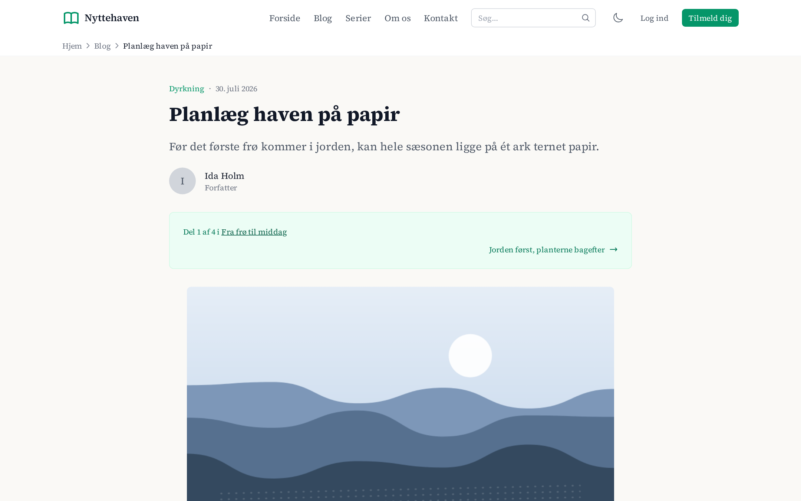
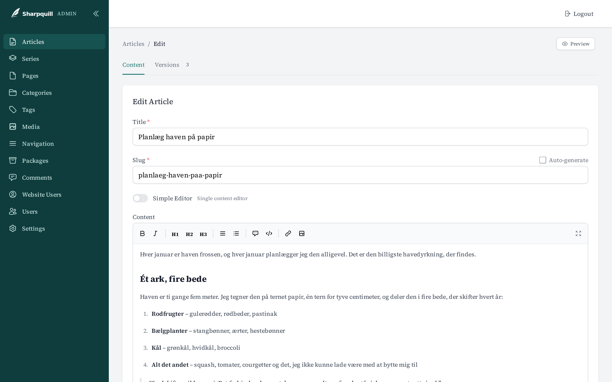
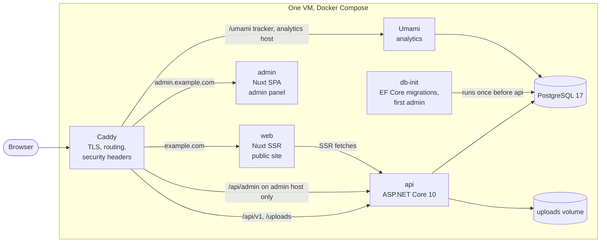

<h1>
  <picture>
    <source media="(prefers-color-scheme: dark)" srcset="assets/brand/logo-dark.svg">
    
  </picture>
</h1>

Sharpquill is a self-hosted CMS and blogging system for people who want to own their website: write articles and pages in an
admin panel, publish them to a fast server-rendered public site, and run the whole thing with Docker Compose on a
single small VM.

It is also an **example of AI-assisted development**. Most of the code was written by AI coding agents (Claude Code
and Codex) working from a task backlog, with a human deciding what to build and checking the results. How that
worked, including what went wrong, is described in [docs/ai-workflow.md](docs/ai-workflow.md).

| Public website | Admin panel |
| --- | --- |
|  |  |

A feature tour with screenshots of every part of the system is in the brochure,
[marketing/sharpquill-brochure.pdf](marketing/sharpquill-brochure.pdf).

## Features

- **Content:** articles and pages written in Markdown with a block/container layout editor, categories, tags,
  series with ordering, featured images, navigation menus, article versions, link and tweet preview cards.
- **Media:** uploads validated by content, automatic resized image variants.
- **Site settings:** site name, description, footer, language, theme, fonts, light/dark mode, all from the admin
  panel rather than code.
- **Readers:** comments with moderation, likes, optional reader accounts (sign-up approved by an admin,
  passwordless login link) and members-only articles, a contact form that sends email over SMTP.
- **Analytics:** optional [Umami](https://umami.is/) (self-hosted, cookie-less).
- **Portability:** export and import of the whole site as a content package.
- **Security:** separate admin and public hostnames, JWT access tokens with rotating refresh tokens, optional
  client-certificate (mTLS) login for the admin, HTML sanitization, rate limits, security headers in the reference
  proxy config.

The public site's built-in texts are **Danish-first** (see [Site name, footer and language](#site-name-footer-and-language)).

## Architecture



| Part | Tech | Path |
| --- | --- | --- |
| API | C# ASP.NET Core 10, Npgsql, FluentValidation, Markdig, SkiaSharp | `src/backend/api`, `application`, `core` |
| Migrations | EF Core Code First (migrations only) | `src/backend/migrations`, `src/backend/db-init` |
| Public website | Nuxt 4 (Vue 3, SSR) + Tailwind | `src/frontend/web` |
| Admin panel | Nuxt 4 (SPA) + Tailwind, Tiptap editor | `src/frontend/admin` |
| Database | PostgreSQL 17 | |
| Proxy (production) | Caddy | `deploy/Caddyfile.example` |

The API serves two URL spaces: `/api/v1/*` for the public site and `/api/admin/*` for the admin panel, each with its
own JWT audience and CORS policy. In production the admin API is only routed on the admin hostname.
See [docs/api-design.md](docs/api-design.md).

### Data access: raw SQL at runtime, EF Core only for migrations

The runtime never uses EF Core. Repositories in `src/backend/application` write SQL by hand and run it through
**Npgsql** (always parameterized), mapping rows to plain entities. EF Core is used **only** as a schema tool:
the `migrations` project holds a `DbContext` and Code First migrations, and the `db-init` container applies them
before the API starts.

Why split it this way:

- **Queries stay visible.** Every statement the API sends is in the source, can be read, explained and tuned in
  `psql`, and uses PostgreSQL directly (for example `ON CONFLICT` upserts) without fighting an ORM.
- **Schema changes stay safe.** Migrations get EF Core's diffing, versioning and history table, and applying them is
  a separate, observable step (`db-init` exits non-zero and the API does not start if a migration fails).
- **No hidden behaviour:** no lazy loading, change tracking or N+1 surprises in the request path.

The cost is mapping code and keeping the `DbContext` model in sync with the SQL by hand; the integration tests run
against a real PostgreSQL to catch drift. Details: [docs/database-layer.md](docs/database-layer.md) and
[docs/backend-code-structure.md](docs/backend-code-structure.md).

## Quick start (development)

Requires Docker with Compose.

```bash
cp .env.example .env
docker compose up -d
```

| URL                    | What                          |
| ---------------------- | ----------------------------- |
| http://localhost:3000  | Public website                |
| http://localhost:3001  | Admin panel                   |
| http://localhost:5000  | API (`/health`, `/swagger` in dev) |
| http://localhost:3003  | Umami analytics dashboard     |
| http://localhost:5050  | pgAdmin                       |

All ports bind to 127.0.0.1 only. Ports and credentials are set in `.env` (see `.env.example`).

### First login

On the first start `db-init` creates the admin account from `ADMIN_EMAIL` / `ADMIN_PASSWORD` in `.env`.
If `ADMIN_PASSWORD` is empty a random password is generated and printed once:

```bash
docker compose logs db-init
```

### Everyday commands

```bash
docker compose logs -f api            # API logs (code changes in src/backend reload automatically)
docker compose up -d --build web      # rebuild a frontend after code changes
cd src/backend && dotnet test         # backend tests
```

## Site name, footer and language

The public website's name, description, footer text and `<html lang>` come from **Settings** in the admin panel, not
from code. The built-in UI texts are **Danish-first** and ship in Danish and English; the `language` setting picks the
translation. Adding a language takes one locale file (see [docs/frontend-uis.md](docs/frontend-uis.md#site-identity-and-language-policy)).

## Deploying to production

[docs/deployment.md](docs/deployment.md) walks through a single-site deployment on a fresh VM from the published
images, with the reference compose file, Caddyfile, backups and restore drill in [deploy/](deploy/) and
[scripts/](scripts/). Running a site that collects reader data? Read [docs/privacy.md](docs/privacy.md).

## Documentation

| Doc | About |
| --- | --- |
| [docs/project-structure.md](docs/project-structure.md) | Repository layout |
| [docs/backend-code-structure.md](docs/backend-code-structure.md) | Backend layering and naming |
| [docs/database-layer.md](docs/database-layer.md) | Tables, conventions, data access |
| [docs/api-design.md](docs/api-design.md) | URLs, response format, authentication |
| [docs/frontend-uis.md](docs/frontend-uis.md) | The two Nuxt apps |
| [docs/admin-security.md](docs/admin-security.md) | Admin login with client certificates |
| [docs/security-headers.md](docs/security-headers.md) | Proxy security headers |
| [docs/deployment.md](docs/deployment.md) | Production deployment, backups, upgrades |
| [docs/privacy.md](docs/privacy.md) | Personal data and GDPR guidance for operators |
| [docs/ai-workflow.md](docs/ai-workflow.md) | How the project was built with AI agents |

## Contributing and security

See [CONTRIBUTING.md](CONTRIBUTING.md). Please report vulnerabilities privately as described in
[SECURITY.md](SECURITY.md).

## License

[MIT](LICENSE)
